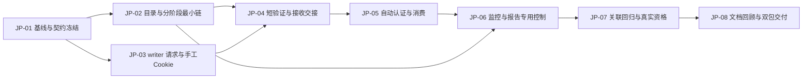

> 公开投影：业务规则与原编号保留；“本轮”指源文档编写阶段。源哈希、路径适配与当前发布范围见 jmeter/docs/publication-context.md 及导出清单。

# 统一开发依赖与阶段出口 v0.1

日期：2026-10-14。JP 编号是**本次计划工作包**，不是已创建的 Issue、执行票、开发轮次或第二套进度账本。REQ/AC/DC 及 WB-FR/WB-AC 原编号保持。当前没有工作包开工或产品测试通过。

## 1. 实施原则

一个规格版本、两套独立候选、一个依赖顺序。开始实施前重新读本包源基线及工作区实际改动，创建新的隔离开发目录；保留原 writer 需求/规格、runner candidate/packaging 和历史证据。先冻结接口，再按端到端行为交付，不能把一个 helper 通过当作整包完成。

runner 为既有消费者，writer 为新生产者。共享模块的改动只按本表顺序合并；即便未来有多人开发，也不能同时覆盖控制器、桥接或预检。本计划本轮未安排子代理或启动任何外部模型。

## 2. 依赖图

JP-02 / JP-03 在逻辑上可独立准备；这是依赖关系，不是并行派发授权。建议顺序实施，减少未固定接口造成的返工。JP-05 与 JP-06 都改 runner 调度/桥接，必须前一提交核对后再进入后一写集。

## 3. 工作包、产物与进入下一包的条件

| 工作包 | 必需开发产物与直接目标 | 前置 | 完成条件 / 验收边界 |
|---|---|---|---|
| JP-01 基线与接口 | 确认实际开发起点；冻结两包能力/协议、正式/验证副本契约、阶段身份、根/预约及认证接口。cURL 原生解析最小资格样例。 | 规格评审、实施范围明确 | 原故事/AC映射不丢；四处已有交付差异有保留方案；G-01 具备实际资格证据，否则生成分支不标可用。协议变更有版本与消费者拒绝条件。 |
| JP-02 目录与独立 report 最小链 | runner 根配置/唯一任务/固定 prepare-round；阶段执行器及真实身份；无 Cookie 的受控 JMX 走“准备→采样→官方 -g→原评分→Word/JSON”。保留原算法。 | JP-01 | 离线 OR-01–09、11、18 与原关联回归覆盖；真实 J-09 需授权后补证。没有报告完成就没有下一档；准备失败不发压。不能只把 CLI 参数拆开当成完成。 |
| JP-03 writer 编写与手工 Cookie | cURL→正式 JMX、静态/动态头、默认断言、手填 CSV 与说明、已有 JMX 分析入口，保持原件。 | JP-01 | W-01–05、10–12、17 的对外产物满足 AC-001/002/005；不支持输入具体拒绝；无凭据输入不伪报认证通过。 |
| JP-04 writer 有限验证与消费者 | 单账号认证 CSV 隔离、1/0/1、副本独立核验、实际样本/断言/消费者分层输出；runner 只读 check-input 及能力标识。交付正式原件而非试跑副本。 | JP-02、JP-03 | W-08/09/11–18、R-01/02/05/11、J-01/04/06 覆盖；默认 runner 接收检查不写正式任务。实际试跑失败后后续目标调用为零。无自动认证也能端到端交接。 |
| JP-05 自动 JSON Cookie 与最小消费 | 同 JMX setUp、固定保存模板/信任摘要、生成依赖、本轮 AuthenticationResult、所有目标/认证精确选择，正式 N 账号与试跑 1 账号各自保留。 | JP-04 | G-02/03 及对应 J-02/03/05/07/08/10 取得实际证据；认证不合格不评分、不回退旧 CSV。完整 JTL 仍进官方报告，报告失败/等待规则保持。未知脚本仍拒绝。 |
| JP-06 监控与报告控制 | 独立监控 CLI、两种真实宿主绑定、一次提醒/续建、控制请求/准确停止/退出待核查、迟到控制防护、宿主使用说明。 | JP-02、JP-05 | OR-12–17 的行为覆盖；G-04 Windows 归属/停止和 G-05 原生通知需实际关闭。监控退出不影响报告，报告停止不影响主任务。整主任务被 Stop 后不自动恢复。 |
| JP-07 联合验收与直接关联回归 | 测完整 writer→runner 交接与正式分阶段执行；异常链、Word/附录/官方指标、原决策与副本边界回归；按 AC 审查实测范围。 | JP-02–06 | 执行本次新增及直接关联集；受控 JMeter / Windows / WorkBuddy 未补齐则逐项 not-tested/inconclusive，不靠 fake 或 pass 数替代。第二环境无资源明确列未测。 |
| JP-08 文档回顾与两包 | 逐份对照最终代码与证据，保留历史基线形成更新版本，记录差异处理；重建清单/敏感扫描；writer 与 runner 各自安装/使用/兼容说明和干净候选包。 | JP-07 的实际结果与剩余限制已核准 | 包与代码、协议、说明相符，已知限制醒目。未取得新能力实机资格不得写正式全量验收通过。打包不等于安装、发布、同事环境资格或 GitHub 推送。 |

上表的真实测试是后续实施出口，**当前没有获得执行具体 JMeter/WorkBuddy 任务的授权**。可以在工作区开发范围另行明确后先完成离线部分；不能静默把缺少实机证据的阶段改成通过。

## 4. 第一条完整最小链

采用无 Cookie 的合成 cURL，使 writer 生成有默认断言的正式原件；固定验证副本跑 1/0/1，验证结果绑定指定 runner 接收；另行确认 runner 正式任务和根，强制准备一档合法并发，官方采样→独立报告→目标行→Word/JSON。

选择无 Cookie 不是删减自动认证需求：它先证明生产者/消费者、两种副本、根布局和官方指标交接没有冲突；自动认证随后在同一协议扩展内关闭全部 AC。真实实现时此链的并发/时长/目标由专项受控授权决定，不沿用历史公共站点或 50–500 的业务负载。

## 5. 资格门与失败处理

| 门 | 所属包 | 实证要求 | 失败后的范围 |
|---|---|---|---|
| G-01 原生生成 | JP-01/03 | 本机 5.6.3 无头解析/原生保存及语义回显；可交付的 helper 形式 | 不支持转换的分支不就绪；记录原因再修订最薄适配，不上传数据或安装替代平台。 |
| G-02 认证/生成依赖 | JP-05 | setUp 顺序、N/1隔离、原生 CSV/属性/文件基准、非当前组、失败不发依赖业务 | 自动模式不能验收，不能放宽正式 JMX 白名单绕过。 |
| G-03 消费者 | JP-04/05 | 实际指定新版接收、旧标准计划保持、任意脚本仍拒绝、桥接/控制器一致 | 未适配消费者明确拒绝/未知，writer 可执行不补算兼容通过。 |
| G-04 Windows 报告归属 | JP-06 | 报告 cmd/Java 正确进入限定 Job/句柄归属，宿主嵌套、无 breakaway、真实退出及主/监控保护 | 无法资格化则报告专用停止不可声称可用；未知不推进，回到技术设计，不扩大杀树范围。 |
| G-05 原生宿主交接 | JP-06/07 | 两真实后台ID、满600秒一次提醒、自退完成通知、先续建后问答、准确用户控制和迟到答复 | 离线逻辑通过保留，宿主资格仍未通过；不承诺主动推送或无空窗。 |

资格检查失败属于对应工作包未完成，不“改名新版本”消除失败记录；后续修订先固定根因/准确写集及关联验证。UI-Test/MPS 的历史票额不适用于本联合项目，不借用或制造新额度。

## 6. 验证、评审与变更协作

每个工作包记录本次源 hash、改动、对应原 AC、实际验证、缺口和下一步；如使用执行流程，沿用该流程唯一权威，不把本计划的依赖表当成执行状态。提交后以完整对外行为审查，不以模块测试数代替 AC。

先验证新增模块与直接调用者；共同入口/存储/阶段结构变化直接影响 bridge、summary、report证据读取及入口测试，应纳入本轮。search 算法不改，只做相关固定边界回归；只有共享接口影响扩大或新失败出现才扩展检查，不每轮重复无关全量。

文档回顾放在交付前且早于发布清单。最终回顾列表：两个 SKILL、调用/配置/支持输入/报告字段/宿主说明、共享契约与模板、验证结果/汇总 schema、安装部署与使用说明、需求/规格差异和测试结果。用准确最终实现重写说明，保留旧版本，不能把计划写成已经部署。

## 7. 后续路由边界

本联合规格的 tracker 已由用户指定为 Zengxiansheng007/codex-skills，并确认默认 triage 词表；本次建立联合规格 Issue，尚未创建8个工作包的开发票。确认实际联合版本后可进入 to-tickets，按本依赖拆票并保留原需求/AC映射；仓库选择依据是本次用户明确指令，认证条目本身仍不是权限或目标来源。远程发布时应使用最终可审查文件，而不是本稿占位或历史单方规格。
